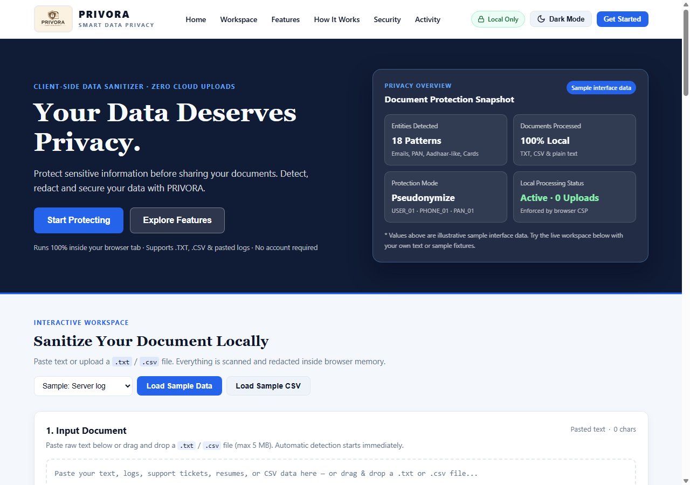
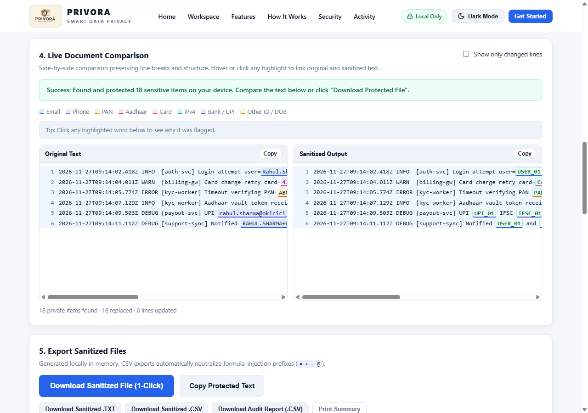
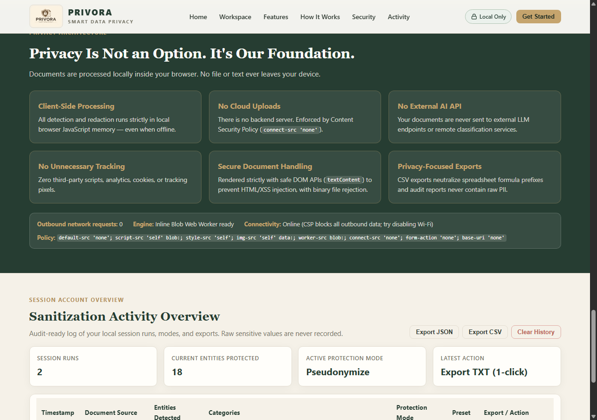
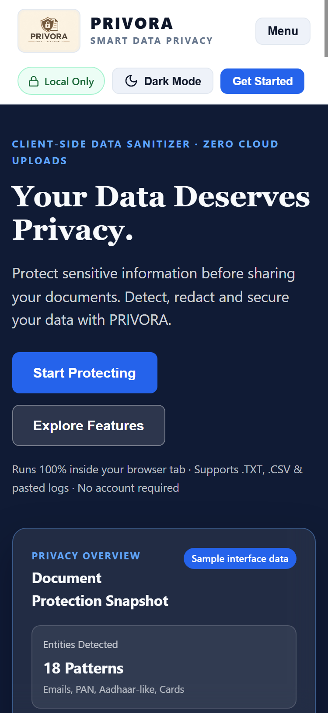
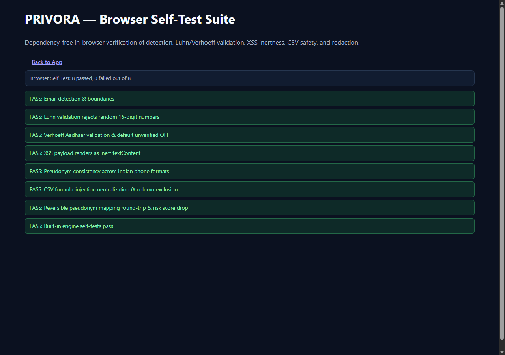
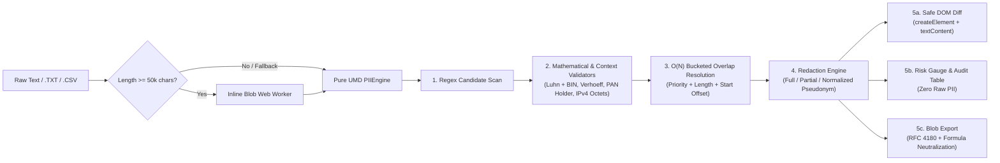

# PRIVORA — Smart Data Privacy

<p align="center">
  
</p>

**Zero-server, 100% browser-based PII detection, validation, and sanitization engine.**  
Paste raw application logs, support tickets, resumes, clinical notes, or CSV exports — PII SENTINEL detects, validates, highlights, audits, and redacts sensitive entities **entirely inside your browser** with zero network requests and strict Content Security Policy enforcement.

> **Disclaimer:** Pattern-based detection. Does not guarantee identification of every PII value. Not official Aadhaar/PAN verification. Review output before sharing.

---

## Problem Statement & Why Client-Side Matters

Teams routinely paste logs, support tickets, resumes, and clinical notes into collaboration tools, issue trackers, and AI assistants — inadvertently leaking emails, Indian mobile numbers, PANs, Aadhaar numbers, IPv4 addresses, and payment cards.

Uploading sensitive records to a "cloud sanitizer" creates a paradox: **you have to trust a third-party server with raw PII just to remove PII.**  
PII SENTINEL solves this by running 100% locally in JavaScript (plus an inline Blob Web Worker for large files), enforced by a strict `connect-src 'none'` CSP so raw data can never leave your browser tab.

---

## Screenshots

| Desktop Dashboard | Side-by-Side Live Diff |
| :---: | :---: |
|  |  |

| Zero-Outbound Privacy Proof & Export | Mobile Responsive (375 px) |
| :---: | :---: |
|  |  |

| Browser Self-Test Suite |
| :---: |
|  |

---

## Mandatory Requirements Checklist (M1–M5)

| Req | Requirement | Implementation in Code |
| :---: | :--- | :--- |
| **M1** | Detect & highlight emails, Indian phones, IPv4, PAN, Aadhaar, credit cards | `detectPII()` in `script.js`; DOM `<mark>` highlighting in `renderDiffPanel()` (`index.html`, `style.css`) |
| **M2** | Luhn validation so random 16-digit numbers are NOT flagged | `luhnCheck()` + `detectCardBrand()` (Visa, Mastercard, Amex, RuPay, Discover) in `script.js` |
| **M3** | Three redaction modes: Full Mask, Partial Mask, Consistent Pseudonymization | `redactText()`, `partialMask()`, `getPseudonym()`, `normalizeForPseudonym()` in `script.js` |
| **M4** | Live side-by-side diff, entity counts, 1-click download | `renderDiff()`, `renderStatCards()`, `renderAuditTable()`, `handlePrimaryDownload()` in `script.js` |
| **M5** | Working web app, 1-click sample noisy text loader, diff view, downloadable output, Prompt Log | `SAMPLES`, `#btnLoadSample`, `#section-diff`, `#btnDownloadPrimary`, `#section-log`, and [`PROMPTS.md`](PROMPTS.md) |

---

## Key Features

- **Core & Extended Detectors:** Emails, Indian Mobile Phones (`+91`, `91`, `0`, bare 10 digits), IPv4 (strict 0–255), Indian PAN (4th-char holder validation), Indian Aadhaar (Verhoeff checksum), Credit/Debit Cards (Luhn + BIN brand), plus toggleable UPI ID, IFSC, GSTIN, Indian Passport, Voter ID, Vehicle Registration, and context-gated Bank Account & DOB.
- **Policy Presets:** One-click compliance bundles for **India DPDP Act 2023**, **PCI-DSS**, **GDPR-style**, and **Developer Logs / Safe for AI**.
- **Risk Exposure Gauge:** 0–100 weighted risk score showing Before vs. After sanitization drop.
- **CSV Intelligence:** RFC 4180 CSV parser (quoted commas & embedded newlines), per-column PII profiling, header-name signals, per-column include/exclude toggles, and formula-injection neutralization (`= + - @ \t \r` prefixed with `'`).
- **Accuracy Honesty Inspector:** Click any highlighted span to view confidence score, validator name, and exact detection rationale.
- **Opt-In Reversible Pseudonymization:** Explicitly download/restore session pseudonym mapping JSON locally without ever persisting PII automatically.
- **5-Step Guided Demo Tour, Dark/Light Theme, Keyboard Shortcuts (`?`), Print-Friendly Audit View, and In-App Self-Test Badge (`8/8 passed`).**

---

## Tech Stack

- **Frontend:** Vanilla HTML5, CSS3, and zero-dependency ES5/ES6 JavaScript (`index.html`, `style.css`, `script.js`)
- **Engine Architecture:** Pure UMD module (`createPIIEngine`) supporting Node.js (`module.exports`), Browser (`window.PIIEngine`), and an **inline Blob Web Worker** (with automatic main-thread fallback for large inputs & `file://`)
- **Icons & Visuals:** Inline SVGs (logo, favicon, risk gauge) and system font stack — **zero CDNs, zero external scripts/fonts**
- **Tests:** Dependency-free Node suite (`test-engine.js`) and browser suite (`tests.html`)

---

## Architecture Diagram



---

## How Detection & Validation Work

1. **Candidate Extraction:** Boundary-aware regexes locate candidate spans without mutating the input string.
2. **Domain Validators:**
   - **Luhn + Brand BIN Check (Cards):** Rejects random 16-digit order IDs/tracking numbers.
   - **Verhoeff Checksum (Aadhaar):** Validates 12-digit numbers starting `2–9`. Checksum failures are flagged low-confidence (`Aadhaar-like (checksum failed)`) and **OFF by default**.
   - **PAN Holder Code:** Checks `[A-Z]{5}[0-9]{4}[A-Z]` and verifies the 4th character (`P, C, H, F, A, T, B, L, J, G`); lowercase matches receive lower confidence.
   - **IPv4 Strict Octets:** Ensures each octet is `0–255` without leading-zero ambiguity and rejects longer dotted version chains like `1.2.3.4.5`.
   - **Context Gating:** Bank accounts and DOBs require immediate preceding label keywords (`account`, `a/c`, `dob`, `birth`, etc.) so log dates like `2026-11-27` or order IDs are ignored.
3. **Overlap Resolution (`resolveOverlaps`):** Candidates are sorted by strict priority (`EMAIL > UPI > CARD > AADHAAR > PAN > GSTIN > IFSC > PHONE > IPV4 > ...`), then longest span, then earliest offset, and resolved in `O(N)` using 256-character spatial buckets. A Luhn-valid 16-digit card is never double-reported as Aadhaar or Phone, and email domains are never re-detected as IPs or UPI handles.

### Luhn Worked Example (`4111 1111 1111 1111` vs `4111 1111 1111 1112`)
Starting from the rightmost digit and doubling every second digit (subtracting `9` if `> 9`):
- `4 1 1 1 1 1 1 1 1 1 1 1 1 1 1 1`: doubled positions = `8 + 2 + 2 + 2 + 2 + 2 + 2 + 2 = 22`; undoubled = `1*8 = 8`; total = `30` (`30 % 10 === 0` -> **Valid Visa**).
- `4 1 1 1 1 1 1 1 1 1 1 1 1 1 1 2`: total = `31` (`31 % 10 !== 0` -> **Rejected**).

### Verhoeff Explanation (Aadhaar)
Unlike simple modulo-10 sums, the **Verhoeff algorithm** uses the dihedral group $D_5$ multiplication table (`VERHOEFF_D`), a position-dependent permutation (`VERHOEFF_P`), and inverse lookup to catch **100% of single-digit errors and adjacent digit transpositions**. All fictional Aadhaar numbers in PII SENTINEL samples were generated directly via the Verhoeff algorithm.

---

## Redaction Modes

| Entity | Original | Full Mask | Partial Mask | Consistent Pseudonymize |
| :--- | :--- | :--- | :--- | :--- |
| Email | `rahul@gmail.com` | `[REDACTED]` | `ra***@gmail.com` | `USER_01` |
| Phone (IN) | `+91 9876543210` | `[REDACTED]` | `+91 ******3210` | `PHONE_01` |
| PAN | `ABCPE1234F` | `[REDACTED]` | `XXXXX1234X` | `PAN_01` |
| Aadhaar | `2345 6789 0124` | `[REDACTED]` | `XXXX XXXX 0124` | `AADHAAR_01` |
| Credit Card | `4111 1111 1111 1111` | `[REDACTED]` | `XXXX XXXX XXXX 1111` | `CARD_01` |
| IPv4 | `192.168.1.100` | `[REDACTED]` | `192.***.***.***` | `IP_01` |

*Consistent Pseudonymization normalizes values (lowercasing emails; stripping `+91`, leading `0`, and separators from phones) so `+91 9876543210`, `09876543210`, and `+91-98765-43210` all map to `PHONE_01`.*

---

## Privacy Architecture & How to Verify It

- **Strict Content Security Policy (No `'unsafe-inline'` on main app):**
  ```
  default-src 'none'; script-src 'self' blob:; style-src 'self'; img-src 'self' data:; worker-src blob:; connect-src 'none'; form-action 'none'; base-uri 'none'
  ```
- **Zero-XSS & Binary-Safe Parsing:** Diff spans and tables are built strictly via `document.createElement` and `textContent` — `innerHTML` is never used on user input. Uploaded files are checked for type, 5 MB cap, and null-byte binary payloads before parsing.
- **How Judges Can Verify:**
  1. Open Chrome DevTools -> **Network** tab -> reload the page -> load sample text, switch modes, and export -> observe **0 network requests** after initial load.
  2. Turn off Wi-Fi / enable DevTools **Offline** mode (or open `index.html` directly via `file://`) — everything works identically.
  3. Inspect `localStorage` and `sessionStorage` in DevTools Application tab: `sessionStorage` is empty, and `localStorage` stores only non-sensitive UI toggles (mode & category flags) — **zero text, files, PII, or pseudonym maps**.

---

## Limitations & Honest Disclaimer

- Regex + checksum detection cannot reliably catch unstructured free-text PII such as person names without consistent formatting, street addresses, or proprietary internal IDs.
- Verhoeff and Luhn checks validate mathematical structure, **not** whether an Aadhaar, PAN, or card is officially active or issued.
- Always perform a human review of sanitized output before external sharing.

---

## How to Run

**Option 1 — Direct Offline File:**  
Double-click `PII-Data-Sanitizer/index.html` to open directly in any modern browser (`file://`).

**Option 2 — Local Static Server:**
```bash
cd PII-Data-Sanitizer
npx serve .
# or: python -m http.server 4173
```

---

## How to Run Tests

- **Node.js Suite (19 assertions):**
  ```bash
  node PII-Data-Sanitizer/test-engine.js
  ```
- **Browser Suite (8 assertions):**  
  Open `PII-Data-Sanitizer/tests.html` in your browser, or click the **`Engine self-test: 8/8 passed`** badge in the app footer.

---

## Roadmap

- Optional client-side WebAssembly NER model (opt-in local download) for unstructured person names and street addresses
- PDF / DOCX client-side text extraction and redacted PDF export
- Custom regex rule builder with live conflict checker

---

## 3-Minute Live Demo Script

1. **0:00–0:30 — Privacy Proof:** Point out the pulsing **LOCAL PROCESSING ONLY** badge, strict CSP in Section 5, and open the DevTools Network tab (or go offline).
2. **0:30–1:10 — Noisy Sample & False-Positive Resistance:** Click **Load Sample Noisy Text** (`Server log`). Show `18` detected entities while random 16-digit order/tracking IDs (`9910284756102938`, `8842190037112204`), bad Luhn (`4111111111111112`), bad Verhoeff (`2345 6789 0125`), and `1.2.3.4.5` are **not** falsely flagged.
3. **1:10–1:50 — Interactive Diff & Modes:** Hover/click `Rahul.Sharma+dev@example.com` and `4111 1111 1111 1111` to show linked highlighting + confidence/validator rationale. Switch between **Full Mask**, **Partial Mask**, and **Consistent Pseudonymize** (showing repeated emails/phones across formats unify to `USER_01` / `PHONE_01`).
4. **1:50–2:30 — Compliance & CSV Intelligence:** Click **India DPDP Act 2023** preset, then click **Sample CSV** to show per-column PII detection and include/exclude toggles. Point out the Risk Gauge dropping from `100/100` to `0/100`.
5. **2:30–3:00 — 1-Click Export & Prompt Log:** Click **Download Sanitized File (1-click)**, note formula-injection protection, show the Session Activity Log, and link to [`PROMPTS.md`](PROMPTS.md) and the `8/8` self-test footer badge.

---

## Prompt & Engineering Log
See [`PROMPTS.md`](PROMPTS.md) for the complete chronological record of prompts, outputs, bugs found, and fixes applied.
